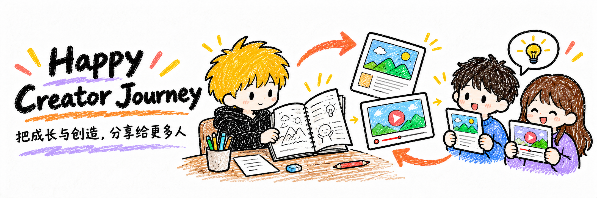

# 安静的创作分享之旅

从真实成长与作品出发，探索图文、视频和多平台分享，积累个人 IP 的创作实践与反馈。

## 为什么做

让成长与创造不止留在自己这里：把有用的经历、作品和思考表达清楚，让需要的人看见、理解和使用，再把真实反馈带回下一次创作。

先帮助自己建立持续分享的方式，再把经实践检验的方法分享给别人。影响力是长期结果，不用播放量代替内容价值。

## 怎样积累

真实经历／作品 → 选题 → 图文或视频 → 多平台发布 → 反馈 → 复盘改进。

| 入口 | 积累内容 |
| --- | --- |
| [创作案例](cases/README.md) | 从原始问题到成品与复盘的完整过程 |
| [发布实验](experiments/README.md) | 表达、形式和平台适配的假设与观察 |
| [可复用资产](assets/README.md) | IP 规范、配图提示词、脚本、版式与检查清单 |
| [实践总结](practices/README.md) | 已验证的经验、适用条件与反例 |
| [开始一次创作](templates/creation-case.md) | 用一份模板串起素材、发布和反馈 |

## 当前起点

项目刚开始：尚无已完成的发布案例，不宣称已有通用的最佳实践。

第一次尝试可以从一个亲历的问题或已经做出的作品开始。先确认受众和要传递的一件事，完成一篇图文或一条短视频；实际发布后记录链接和反馈，再判断哪些经验值得复用。不预设发布频率，不同时铺满所有平台。

## 记录原则

- 区分事实、假设、个人判断与暂时无法验证的信息。
- 发布实验保留日期、平台、观察窗口和条件；没有记录就不编造数据，相关性不等于因果。
- 不把单次流量、粉丝数量或一次成功推广成普遍规律。
- 公开成品、方法、可公开来源与脱敏复盘；不提交账号凭据、私人原件、未授权肖像、私信和他人隐私。
- 引用保留出处；发布前核对素材的授权范围。公开可见不等于可自由转载。
- AI 辅助创作由人审核事实、表达、权利和最终发布。仓库不自动代发内容。
