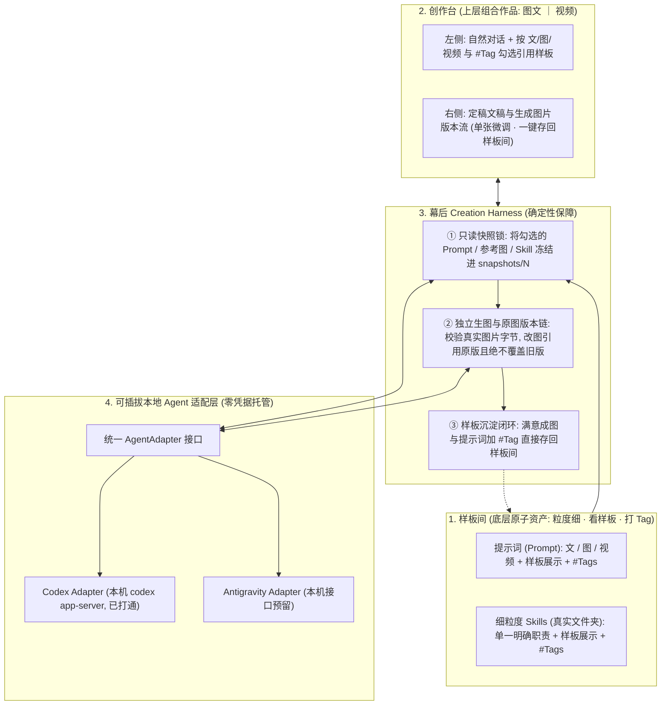

# CreatorX 设计

## 1. 核心定位｜原子样板积木 × 组合创作 Harness

从真实成长与作品出发，探索并沉淀自媒体创作最佳实践。

CreatorX 是面向 macOS 与 Windows 的本地创作客户端，**不是重新造一个通用 Agent，而是构建在本地 Agent（Codex、Antigravity 等）之上的极简 Creation Harness（创作治具）**：

- **最底层的原子创作只有三种**：**生文（`文`）**、**生图（`图`）**、**生视频（`视频`）**。
- **对外发布的成品只有两种组合**：**图文**（生文＋生图的组合，如小红书／抖音图文、公众号文章配图）与 **视频**（脚本＋参考图＋视频的组合）。
- **所有资产同构、粒度极细、靠样板与 `#Tag` 组织**：不设特殊的“IP 底座”表单或多层分类目录——无论是“安静”的角色设定、某种粗蜡笔画风、某类技术拆解文风，还是一个精简的单图／改图 Skill，本质上都是一件带**样板效果**和 **`#Tag`（如 `#安静`、`#计算机`、`#金融`）** 的原子资产。创作时按需勾选引用、自由组合。

坚持 **可复用骨架 ＋ 创作者私有数据分离** 与 **Less is more**：界面只呈现对话、样板与作品；快照组装、原图隔离和文件校验在幕后完成。

---

## 2. 总体架构｜一眼看清

工程模块与磁盘沙盒契约见 [客户端架构说明](desktop/ARCHITECTURE.md)。

---

## 3. 样板间与创作流｜极简设计

### 3.1 首页
- 上方约七成高度并排两块无字安静 IP 蜡笔插画：**图文** ｜ **视频**。
- 下方约三成高度横跨整行无字插画：**样板间**。
- 暖米白界面，无可见文字与原生提示，保留读屏名称与键盘聚焦轮廓。

### 3.2 样板间（只留 4 个核心要素）

| 要素 | 取值与形态 | 说明 |
| --- | --- | --- |
| **载体** | `提示词` ｜ `Skill`（文件夹） | 一个资产只做好一件事（如一条角色词、一种画风、一个改图小 Skill）。 |
| **原子方向** | `文` · `图` · `视频` | 对应最底层的生文、生图、生视频。 |
| **样板展示** | 样板图（1～16 张）或输出样例文字 | 画廊卡片第一眼直接展示实际效果；样板图在被引用时自动作为参考图装入快照。 |
| **`#Tags`** | 如 `#安静` `#粗蜡笔` `#计算机` `#金融` | 扁平直观；编辑时自动列出已用过的历史标签供点选复用，避免近义标签打散。 |

GUI 与本地 `creatorx` CLI 共用同一份存储、进程间文件锁与 `revision` 修订冲突检查（详见 [CLI 说明](desktop/CLI.md)）。

### 3.3 创作台（图文 ／ 视频）
1. **按需组合原子样板**：在对话输入框下方点 `＋ 引用提示词`，可按 `文 / 图 / 视频` 或 `#安静` 等标签秒筛勾选多条提示词，并可选配一个精简 Skill（内置 `单张生图`、`系列套图`、`原图微调` 三个原子 Skill，也可使用个人 Skill）。
2. **自然推进，幕后保护**：先与本地 Agent 聊选题、磨文字（定稿内容可同步展示在右侧 `draft.md` 供一键复制）；明确要求出图或改图时，Harness 自动派发独立生图子会话，继承当轮只读快照与参考图，校验真实图片文件并保留每一版原图。
3. **沉淀有效资产**：做出来的成图或文风效果满意时，点击右侧卡片上的 `✦ 存为样板`，填上名称并打上 `#Tag`，连同真实成图一键存回样板间。

---

## 4. 桌面体验与边界约束

- 应用内会话、Skill 与本地 Agent 切换统一使用自定义 `Choice` 米白弹层，不使用原生 `select`／`datalist`。
- macOS 隐藏左上角三个原生窗口按钮，`Command + W` 隐藏窗口保活、`Command + Q` 完全退出；Windows 保留原生窗口按钮。支持 `Command + [`／`]` 与鼠标侧键 `button 3/4` 前进后退，存在未保存内容或弹层打开时保护当前页面。
- OTA 每小时后台静默检查，仅发现新版时显示按钮，创作或编辑进行中阻止安装；使用独立更新签名密钥。macOS 本机退出后的无底板透明图标通过 `desktop/scripts/macos-file-icon.swift` 设置 Finder 自定义图标（仅限本机安装后定制，不进入发行包）。
- 根目录 `README.md` 仅展示经认可的图片；公共仓库绝不提交个人素材库、作品原件或本地凭据。

---

## 5. 当前进度与后续计划｜已核对（`0.1.1`）

- **已完成并验证（`0.1.1`）**：
  - 本机旧 `0.0.17` 数据已完整备份至私有目录 `archive-v0.0.17/`，活动库清零起步；
  - 后端精简为 `library`（`提示词/Skill` ＋ `文/图/视频` ＋ `#Tag` ＋ 样板图片与文字）、`harness`（只读快照锁、独立生图与原图版本保护、一键存样板）与 `adapters`（`CodexAdapter` 已打通，`AntigravityAdapter` 标准预留）；
  - 前端落地“图文／视频＋样板间”首页、Tag 画廊样板间（含历史标签点选复用）与积木组合式创作台；
  - 前后端构建、单测、跨进程 CLI 测试、双平台 CI 与三平台更新签名包均验证通过，本机 `~/Applications/CreatorX.app` 已更新至 `0.1.1`。
- **下一步日常迭代**：
  - [ ] 往干净样板间里逐条沉淀 `#安静` 角色词、常用画风／文风提示词与细粒度创作 Skill，配齐直观样板；
  - [ ] 在真实图文与视频创作中打磨体验，沉淀公开案例至 `cases/` 与 `practices/`；
  - [ ] 按需接入视频生成／渲染细粒度工具、绘制新入口专属插画，并排查历史遗留的 OTA 自动重启窗口唤起异常、核对鼠标侧键真鼠与 Windows 真机交互。
