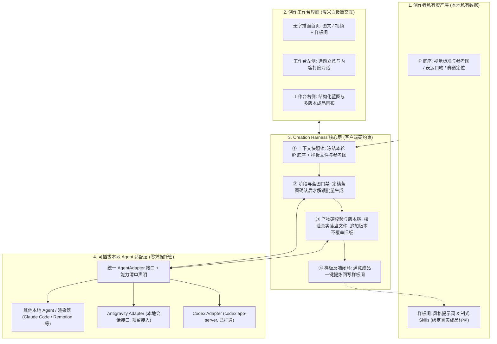
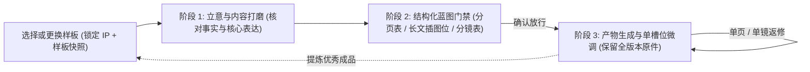

# CreatorX 设计蓝图

## 1. 项目定位｜Creation Harness 客户端

从真实成长与作品出发，探索并沉淀自媒体创作最佳实践。

CreatorX 是 Happy Creator Journey 的本地创作客户端（面向 macOS 与 Windows）。它的核心定位**不是重新造一个通用 Agent，而是构建在本地 Agent 之上的 Creation Harness（创作治具／编排约束台）**：

- **能力借力本地 Agent**：推理、写作、多模态生成与工具调用，交给本机已安装登录的 Agent（当前已打通 **Codex**，架构预留 **Antigravity** 及其他本地 Agent／渲染器），不自建模型服务，不复制托管账号凭据。
- **确定性由 Harness 保证**：通用聊天框容易人设漂移、未定稿就抢跑生图、改一处毁全局、资产越积越乱；CreatorX 用**上下文快照锁、阶段蓝图门禁、产物硬校验与样板间闭环**把创作过程关进可预期、可验收、可复用的轨道。
- **可复用骨架 ＋ 创作者私有数据分离**：客户端工程提供通用的 Harness 流程、制式工作台与内置基础 Skill；创作者自己的 IP 底座（如“安静”）、赛道积累（如计算机、金融、音乐）、样板资产与作品独立保存在本机私有目录，升级不丢、外人拿走骨架即可填入自己的 IP 开工。

日常体验坚持 **Less is more**：**聊透想法 → 确认结构化蓝图 → 按样板生成成品 → 局部微调与沉淀**。复杂约束由底层 Harness 执行，界面保持克制顺手。

---

## 2. 总体四层架构｜已明确蓝图

### Harness 的四道硬保证机制

1. **上下文快照锁（Context Snapshot）**：每次启动或更换挂载资产时，Harness 自动将当前 **IP 底座 ＋ 赛道定位 ＋ 选定样板（Prompt／完整 Skill 目录及参考图）** 复制冻结到任务只读快照目录。底层 Agent 直接读取确定性文件，不靠长对话记忆，外部修改素材库也不污染进行中的任务。
2. **阶段与蓝图门禁（Blueprint Gate）**：禁止从模糊想法直接黑盒跳到整套成图或成片。任何制式都必须先产出结构化**蓝图契约**（每页卡片文案、长文插图锚点或视频分镜表），经工作台确认放行后，才调度生成任务，把返工拦在昂贵渲染之前。
3. **产物硬校验与不可变版本链（Artifact Guard）**：Agent 口头回复“已生成”不算完成——Harness 必须核验 `artifacts/` 下真实产出的文件存在、非空且符合槽位预期；局部微调（如重做第 3 张卡片或第 2 张配图）只追加新版本并引用上一版原图，绝不覆盖历史版本。
4. **可插拔能力协商（Capability-aware Adapter）**：Harness 与底层 Agent 通过**本地标准任务目录契约**解耦，不绑死某一家私有协议。各 Adapter 声明自身支持的原子能力（规划写作／原生生图／图像编辑／脚本渲染），Harness 按实际能力放行或提示。

工程模块与磁盘契约细则见 [客户端架构说明](desktop/ARCHITECTURE.md)。

---

## 3. 资产与样板间体系｜1 个底座 ＋ 2 层样板

不把“计算机／金融／音乐”建成死板的顶层目录（否则通用画风与版式无处安放），而是**纵向按资产职责分层，横向用“赛道”和“成熟度”做轻量属性**，并且**以真实成品样板作为第一浏览视角**。

| 资产层级 | 职责与粒度 | 样板间第一眼展示什么 | 固定分类 |
| --- | --- | --- | --- |
| **1. IP 底座** | “我是谁”的全局基础设定，创作时默认按需带入，免去每次翻找勾选。 | 角色标准形象板（如安静：蛋黄黄乱发、黑卫衣、粗蜡笔纸纹参考图组）＋人设口吻样例＋活跃赛道列表。 | `视觉形象` · `表达口吻` · `内容赛道` |
| **2. 风格提示词** | 单点可复用的画风、构图或行文结构（Prompt＋参考图／文字样板）。 | **有图直接看样板大图；纯文字类直接看“输入选题 → 输出成稿片段”对照卡**，点开再看底层 Prompt。 | `视觉画风` · `写作母版` · `脚本钩子` |
| **3. 制式 Skills** | 把定稿内容变成标准成品的完整生产线（真实文件夹：`SKILL.md`＋参考图＋脚本／规范）。 | **整套代表作成品样板间**（如一组小红书卡片、一篇带插图的公众号排版预览、一组视频分镜样片）＋适用平台说明，支持一键 **“用此样板创作”**。 | `卡片图文` · `长文配图` · `视频创作` |

每项提示词与 Skill 仅维护两个轻量筛选维度：
- **适用赛道**：`通用`（默认）／ `计算机` ／ `金融` ／ `音乐`（随个人赛道自然扩展）。
- **成熟度**：`样板`（已跑通验证、配好样例的主力资产，默认展示）／ `草稿`（随手记录待打磨的试验品，默认折叠不干扰选择）。

本地 GUI 与 `creatorx` CLI 共用同一份存储、进程间文件锁与 `revision` 修订冲突检查。

---

## 4. 首页与三大创作制式｜覆盖主流社媒交付物

### 4.1 首页入口
- 上方约七成高度并排两张无字插画入口：**图文** ｜ **视频**。
- 下方约三成高度横跨整行无字插画入口：**样板间**（内含 **IP 底座**、**制式 Skills** 与 **风格提示词**）。
- 延续安静 IP 粗蜡笔纸白风格与暖米白界面；整块可点击，无可见文字与原生悬浮提示，保留无障碍读屏名称与键盘聚焦轮廓。

### 4.2 三大交付制式与统一三阶流程

社交媒体最终发布的不是孤立的“纯文字”或“无主题单图”，而是 **图文**（分卡片式与长文式）和 **视频**。三种制式共用统一的 **左对话驱动 ＋ 右结构化画布** 范式：

| 所属入口 | 交付制式 | 典型目标平台 | 阶段 2 蓝图契约内容 | 右侧成品工作台结构 |
| --- | --- | --- | --- | --- |
| **图文** | **A. 卡片图文** (`cards`) | 小红书图文、抖音图文 | 发布标题与短配文 ＋ **分页卡片表**（第 1..N 页的页职责、图内准确文字、构图说明） | 顶部短配文 ＋ **按页排列的卡片槽位**；每页展示对应文案与生成的历版原图，支持单页独立重做／改图。 |
| **图文** | **B. 长文配图** (`article`) | 微信公众号长文 | 章节大纲与定稿 Markdown 正文 ＋ **封面及文中插图锚点表**（位置、图意、图内文字） | **阅读级长文成稿预览**（内嵌当前选中配图）＋ **封面／插图槽位列表**；支持单图微调、复制排版文稿与导出原图。 |
| **视频** | **C. 视频创作** (`video`) | 抖音视频、小红书视频 | 核心钩子与口播／旁白逐字稿 ＋ **结构化分镜表**（镜号、台词、画面动作、时长、素材职责） | **口播稿视图** ＋ **分镜时间线卡片（Shot 1..N）**；每镜挂载关键帧参考图／视频提示词包或渲染片段槽位，后续平滑接入视频模型或 Remotion。 |

---

## 5. 桌面体验与交付约束｜延续已验证规范

- **视觉与选择器**：统一暖米白、淡奶油、浅蓝灰与鼠尾草绿；应用内所有下拉、会话切换、样板与分类选择统一使用自定义 `Choice` 米白弹层，不使用系统原生 `select`／`datalist`。
- **窗口与导航**：macOS 隐藏左上角关闭、最小化、全屏按钮，顶部保留拖动，`Command + W` 隐藏窗口保活进程，`Command + Q` 完全退出；Windows 保留原生窗口按钮。页面历史统一支持 `Command + [`／`]` 与鼠标侧键 `button 3/4`，空白输入框聚焦不阻挡导航，编辑未保存或弹层打开时保护当前页面。
- **静默更新与签名**：OTA 约每小时后台静默检查，仅确认有新版时显示更新按钮；存在未保存编辑或运行中创作任务时阻止安装。使用独立 updater 签名密钥（私钥不入库）；macOS 本机 Finder 自定义透明图标仅限本机安装后脚本设置，不进入公开安装包或公证产物。
- **公开仓库边界**：根目录 `README.md` 仅展示经认可的配图；公共仓库只提交可复用骨架、公开配图与脱敏案例总结，个人素材库、创作记录、本机归档与账号凭据绝不入库。

---

## 6. 当前进度与后续推进｜已核对（0.1.0）

### 6.1 已落地并验证的横向底座（`0.1.0`）
- **本机旧数据安全归档清零**：已将 `0.0.17` 时期的 41 条提示词、16 张参考图、1 个私人 Skill 文件夹与 1 条创作记录完整备份至本机私有目录 `archive-v0.0.17/`；客户端当前库已清零，可按新体系干净积累。
- **后端三层解耦（`library` ＋ `harness` ＋ `adapters`）**：
  - `library.rs` 支持 `ip.json`（IP 底座修订锁）、样板／草稿成熟度、赛道标签、三制式属性、安全删除及 `snapshots/<seq>/` 上下文组装，并与 `creatorx` CLI 完全共用存储与锁；
  - `harness.rs` 实现不可变快照递增、`blueprint.json`／`draft.md` 文件契约、蓝图确认门禁、单槽位 `artifacts/<slot-id>/v<N>.<ext>` 追加式文件头硬校验与成品提炼回写样板间；
  - `adapters/` 落地 `AgentAdapter` 统一接口：`CodexAdapter` 已接通本机 `codex app-server`，`AntigravityAdapter` 预留标准本机适配槽位。
- **前端首页、样板间与三制式工作台**：
  - 首页更新为上方“图文 ｜ 视频”、下方整行“样板间”；
  - 样板间提供 `IP 底座`（含安静起步模板一键预填）、`制式 Skills`（内置 5 套样板＋个人库）与 `风格提示词` 画廊浏览及“去创作”直达联动；
  - 创作台覆盖 **卡片图文**（分页卡片＋短配文＋历版切换与单页微调）、**长文配图**（Markdown 内嵌槽位预览＋配图微调）与 **视频创作**（口播逐字稿＋分镜镜头卡＋关键帧／分镜包复制）。
- **自动化验证**：TypeScript 编译与构建、发布校验脚本、前端导航与更新策略单测、Rust 资产库／Harness 四道硬门禁单测及跨进程 CLI 集成测试全部通过。

### 6.2 待验证边界与下一步打磨重点
- [x] **阶段 0～4 横向架构落地**：完成 Creation Harness 四层架构、本机归档清零、IP 底座＋样板间画廊、图文双制式与视频分镜工作台。
- [ ] **首批真实样板积累**：在干净新库中正式立起“安静”IP 底座（配齐标准参考图），并从归档或近期有效实践中精选首批画风／写作提示词与制式 Skill 配好样例上架。
- [ ] **真实创作打磨**：用计算机／金融真实选题跑通小红书卡片图文、公众号长文配图与短视频分镜，按体感微调交互细节，将验证有效的方法沉淀至 `cases/` 与 `practices/`。
- [ ] **专项体验与跨平台收尾**：
  - 绘制贴合“图文”双制式语义的专属首页插画与仓库 `README` 架构手绘配图；
  - 排查修复 **OTA 自动重启后的窗口唤起异常**；
  - 核对鼠标侧键真鼠表现，推进 Windows 真机交互验收、固定视频渲染后端（如 Remotion）及平台代码签名／公证。
