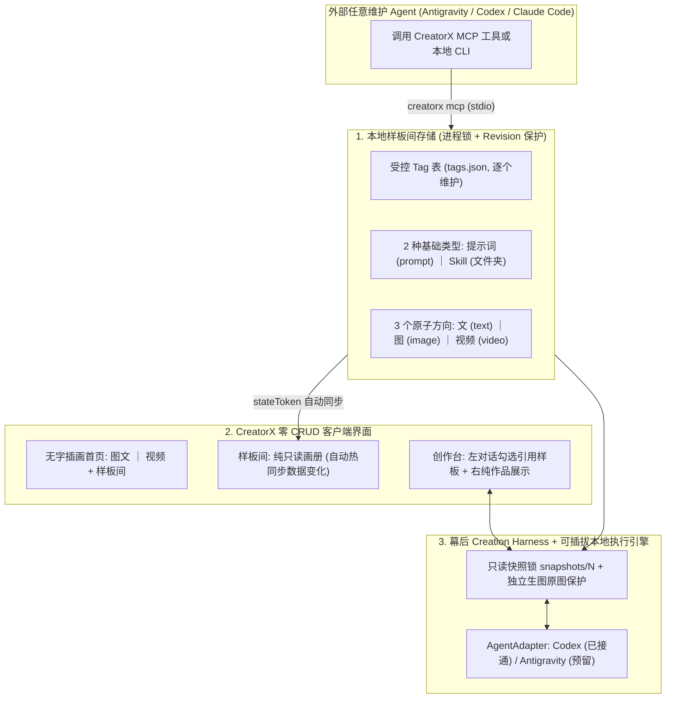

# CreatorX 设计

## 1. 核心理念｜Agent 原生维护 × 零 CRUD 客户端

从真实成长与作品出发，探索并沉淀自媒体创作最佳实践。

CreatorX 是面向 macOS 与 Windows 的本地 **Creation Harness（创作治具）客户端**，遵循两个极简原则：

1. **客户端界面零增删改查（Zero-CRUD UI）**：前端界面剔除一切传统的添加、编辑、删除、搜索框与标签管理表单——只做纯粹的**样板画册浏览**与**创作对话舞台**。
2. **资产全由 Agent 通过 MCP／CLI 维护**：同一个 `creatorx` 可执行文件内置标准 **MCP Server（`creatorx mcp`）** 与 **CLI JSON API**。无论客户端窗口开没开，Antigravity、Codex、Claude Code 等任何 Agent 都可以直接调用工具维护提示词、Skill、样板图和受控 Tag；客户端窗口打开时自动检测数据变化并无感热同步。

---

## 2. 总体架构

工程模块与 MCP 协议定义见 [客户端架构说明](desktop/ARCHITECTURE.md) 与 [MCP ＆ CLI 说明](desktop/CLI.md)。

---

## 3. 最简数据与界面结构

### 3.1 数据模型（不再增加多余分类概念）
- **基础类型（`kind`）**：只有 2 种 —— **`prompt`（提示词）** ｜ **`skill`（Skill 真实文件夹）**。
- **原子方向（`modality`）**：只有 3 种 —— **`text`（文）** ｜ **`image`（图）** ｜ **`video`（视频）**。
- **受控标签（`tags`）**：在 `tags.json` 中逐个显式维护（如 `安静`、`粗蜡笔`、`计算机`、`金融`）；未先登记的标签拒绝写入，重命名或删除标签时自动同步所有关联资产。
- **样板展示**：每件资产直接关联样板图片（`images[]`）或样板文字（`sample`）。

### 3.2 界面结构（纯浏览 ＋ 纯创作）
- **首页**：上方并排 **图文 ｜ 视频** 两块无字安静蜡笔插画，下方整行为 **样板间** 无字插画。
- **样板间**：仅保留轻点切换 `提示词 / Skill`、`文 / 图 / 视频` 与已登记的 `#Tag` 胶囊，浏览样板图与内容，一键带入创作台；无任何输入框与增删改按钮。
- **创作台（图文 ／ 视频）**：左侧与本地 Agent 对话，按需勾选引用已有提示词与细粒度 Skill（后台自动冻结 `snapshots/<seq>/`）；右侧纯粹展示定稿内容与历版生成图片（点击放大查看，原图版本永不覆盖）。

---

## 4. 当前进度｜已核对（`0.1.2`）

- **已完成并验证（`0.1.2`）**：
  - 移除前端所有传统增删改查控件、编辑页、搜索框与内联表单；样板间支持基于 `stateToken` 的自动无感热刷新；
  - 落地受控 Tag 表与内置标准 **`creatorx mcp`（Stdio JSON-RPC 2.0）** 服务（共 11 个原子工具），并已注册进本机 Antigravity 全局 MCP 配置（`~/.gemini/config/mcp_config.json`）；
  - 本机历史旧数据保留在私有备份目录 `archive-v0.0.17/`，活动库干净起盘；
  - 前后端构建、单测、MCP ＆ CLI 跨进程测试、GitHub 双平台检查与三平台更新签名包验证通过，本机 `~/Applications/CreatorX.app` 已更新至 `0.1.2`。
- **待验证与后续推进**：
  - 直接用 Antigravity 等 Agent 通过 MCP 逐个建立受控 Tag、迁入或新增提示词与细粒度 Skill 样板；
  - 历史遗留项保持如实记录：OTA 自动重启后窗口唤起异常待排查、鼠标侧键待真鼠实测、Windows 真机交互与平台代码签名／公证待后续推进。
