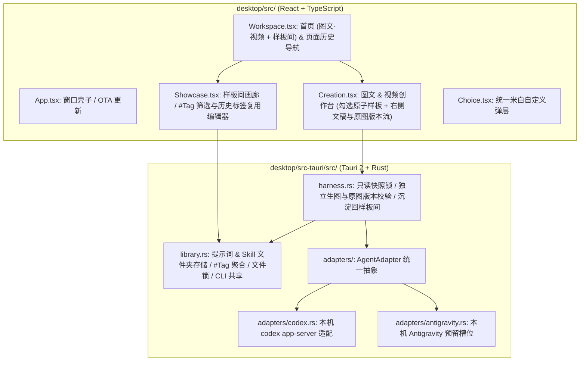

# CreatorX 客户端架构（`0.1.1` 极简 Creation Harness）

本文档说明 `desktop/` 客户端的模块分层、本地磁盘沙盒契约与本地 Agent 适配器接口。

---

## 1. 模块分层



---

## 2. 本地磁盘数据与沙盒文件契约

所有私有数据保存在系统 `app_data_dir`（macOS 为 `~/Library/Application Support/cc.anjing.creatorx/`），与代码仓库完全隔离：

```text
<app_data_dir>/
├── archive-v0.0.17/                   # 历史旧数据本机私有归档备份
├── library/                           # 1. 样板间存储（GUI 与 CLI 共用 .lock 文件锁）
│   ├── entries/<entry-id>.json        # 原子资产记录：kind(prompt|skill), modality(text|image|video), sample, tags[], images[], revision
│   ├── images/<sha256>.<ext>          # 按内容去重的原字节样板图／参考图
│   └── skills/<entry-id>/             # 细粒度 Skill 真实文件夹（SKILL.md + 资源/脚本）
└── creations/                         # 2. 创作任务沙盒（.lock 互斥锁保护）
    └── <job-id>/
        ├── job.json                   # 会话记录：mode(image_text|video), adapterId, snapshotSeq, messages, images
        ├── AGENTS.md                  # 任务沙盒边界说明
        ├── draft.md                   # 定稿文案／长文／分镜脚本（自动同步至右侧展示）
        ├── snapshots/<seq>/           # 第 seq 轮冻结的只读输入快照（切换引用递增，旧快照不改）
        │   ├── prompts.md             # 当轮勾选的 #Tag 提示词正文与样板说明
        │   ├── skill/                 # 当轮选定细粒度 Skill 的文件夹副本
        │   ├── references/            # 当轮关联参考图原字节副本
        │   └── materials.json         # 快照结构化索引
        ├── previous/                  # 仅改图子任务存在：复制自源任务的真实上一版原图
        └── artifacts/                 # 真实生成的图片产物（校验文件头，追加保存绝不覆盖）
```

---

## 3. Harness 三项核心保证

1. **只读上下文快照锁**：用户在对话中勾选或更换 `#Tag` 提示词与细粒度 Skill 时，Harness 自动生成新的 `snapshots/<seq>/`，保证每次交给本地 Agent 的文件与参考图确定、可追溯，且不污染原样板间。
2. **独立生图子会话与原图保护**：主会话通过 `creatorx_generate_image`（或右侧卡片“基于原图微调”按钮）拉起隔离的生图子任务；改图强制校验并复制源任务真实原图至 `previous/`，新成图通过 PNG／JPEG／WebP 魔数校验后落盘 `artifacts/`，源任务原图字节保持不变；未产出有效图片文件时明确报错。
3. **可插拔 `AgentAdapter`**：`adapters/mod.rs` 定义统一的会话启动、流式事件、工具回调与能力声明（`Planning`、`ImageGeneration`、`ImageRevision`、`WorkspaceExec`）。首期由 `CodexAdapter` 驱动本机 `codex app-server`，`AntigravityAdapter` 预留本地接口扩展。
