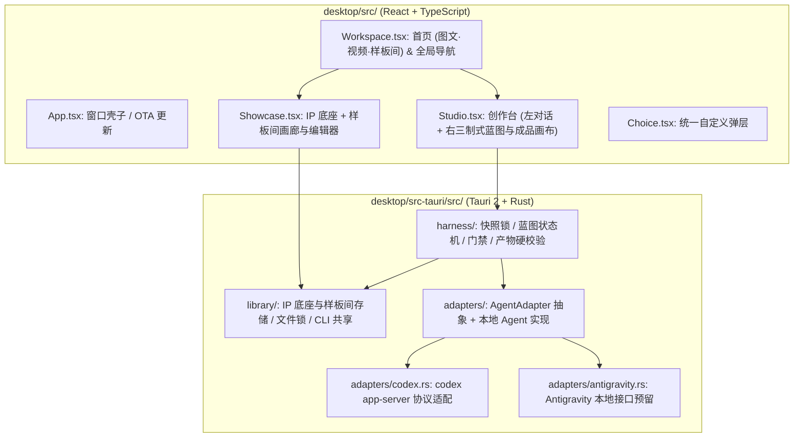
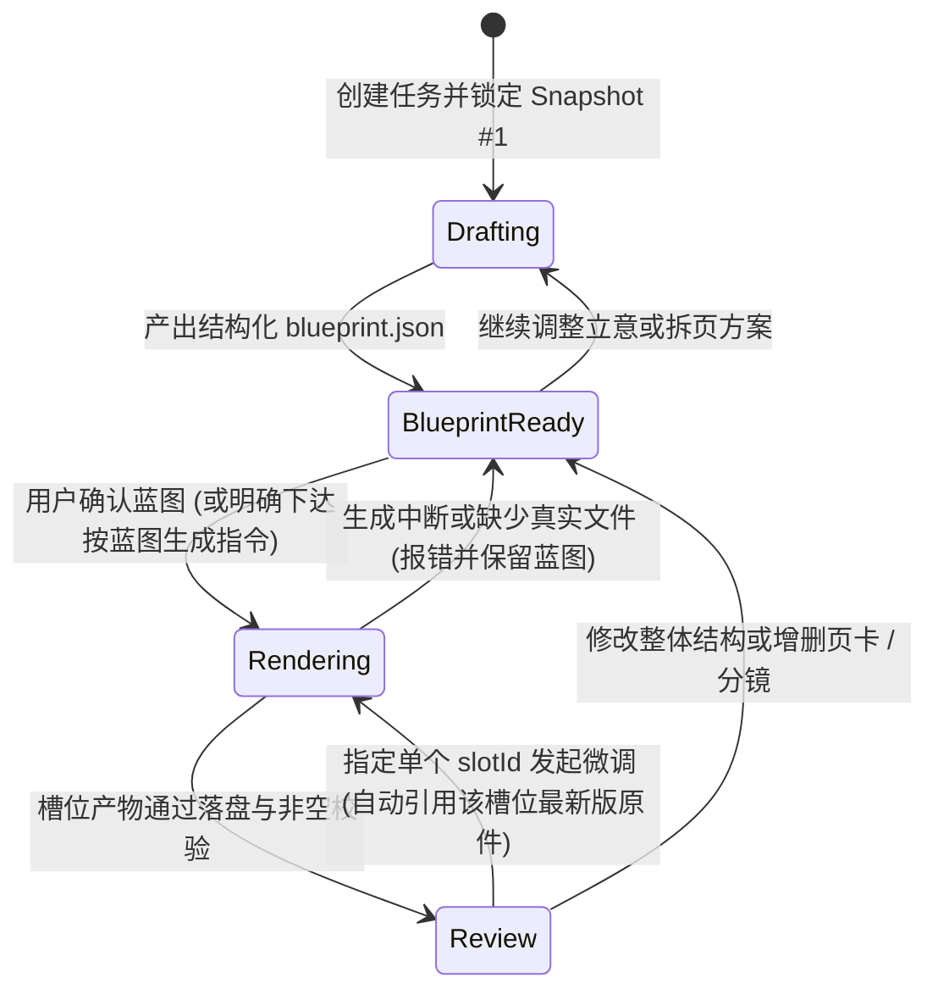

# CreatorX 客户端架构（Creation Harness 工程规范）

本文档定义 `desktop/` 客户端的模块边界、磁盘契约、Harness 硬门禁规则与本地 Agent 适配器接口，确保代码实现严格遵循 **“Creation Harness ＋ 可插拔本地 Agent ＋ 骨架与私有数据分离”**。

> 状态说明：本文档对应 CreatorX `0.1.0` 已落地的工程架构实现；日常运行与测试说明见 [README.md](README.md) 与 [CLI.md](CLI.md)。

---

## 1. 模块分层与源码目录目标结构

将原本集中在单一 `codex.rs` 中的“任务状态、编排规则、RPC 通信”拆解为职责单向依赖的三层后端与对应前端视图：



| 层级／目录 | 核心职责 | 明确不做什么 |
| --- | --- | --- |
| `library`（资产层） | 读写 `ip.json`（IP 底座）与样板间条目（提示词、完整 Skill 文件夹、样板图片／文字样例）；提供跨进程文件锁与 `revision` 乐观锁；同时支撑 GUI 与 `creatorx` CLI。 | 不启动任何 Agent 进程，不耦合具体创作会话状态。 |
| `harness`（治具核心层） | 管理创作任务生命周期、生成只读上下文快照、维护三大制式（`cards`／`article`／`video`）的结构化蓝图契约、执行阶段门禁、校验 `artifacts/` 真实文件与不可变版本链、支持将成品提炼回 `library`。 | 不直接拼装某一家 Agent 的私有 JSON-RPC 或 HTTP 报文。 |
| `adapters`（Agent 适配层） | 实现 `AgentAdapter` trait：探测本机可用 Agent、声明能力清单、将 Harness 组装好的任务工作区与阶段指令映射给对应本地 Agent 执行，并把流式事件／工具请求回传给 Harness。 | 不绕过 Harness 直接篡改历史产物，不持久化或复制用户的第三方账号凭据。 |

---

## 2. 本地磁盘数据与任务沙盒契约（Workspace File Contract）

为了让 Codex、Antigravity 或后续其他本地 Agent 都能无缝接入同一套创作流程，Harness 采用**本地磁盘文件契约**作为跨 Agent 的通用真相源（位于系统 `app_data_dir`，与公共代码仓库彻底隔离）：

```text
<app_data_dir>/                        # macOS: ~/Library/Application Support/cc.anjing.creatorx/
├── archive-v0.0.17/                   # 本机历史数据私有归档备份（不随新库加载，可随时按需提取）
├── library/                           # 1. 创作者私有资产库
│   ├── library.lock                   # 跨进程互斥锁（GUI 与 CLI 共用）
│   ├── meta.json                      # 赛道列表（如：计算机、金融、音乐）与全局分类元数据
│   ├── ip.json                        # IP 底座：名称、人设口吻、视觉标准 Prompt、标准参考图引用
│   ├── entries/<entry-id>.json        # 提示词或 Skill 记录（含 kind、deliverable、track、maturity、showcase）
│   ├── images/<sha256>.<ext>          # 按内容哈希去重的原字节图片（参考图与样板成品图）
│   └── skills/<entry-id>/             # Skill 真实文件夹（SKILL.md + references/ + scripts/ 等）
└── creations/                         # 2. 创作任务沙盒目录
    └── <job-id>/
        ├── job.json                   # 任务主记录：制式 (cards|article|video)、阶段、消息流、所用 adapter
        ├── snapshots/
        │   └── <seq>/                 # 第 seq 轮冻结的只读输入快照
        │       ├── ip.md              # 当轮生效的 IP 底座快照与参考图副本
        │       ├── prompts.md         # 当轮附加的风格提示词快照
        │       └── skill/             # 当轮选定 Skill 文件夹的完整快照（含内置或私有 Skill）
        ├── draft.md                   # 阶段 1/2：正在打磨或已定稿的正文／口播文稿
        ├── blueprint.json             # 阶段 2 门禁核心：结构化蓝图契约（分页卡 / 插图锚点 / 分镜表）
        └── artifacts/                 # 阶段 3 产物区（Append-only，禁止覆盖旧文件）
            └── <slot-id>/             # 对应某张卡片、某个插图位或某个分镜槽位
                ├── v1.png             # 初始生成原件
                └── v2.png             # 引用 v1 修改后的新版本原件
```

---

## 3. Harness 状态机与四道硬门禁细则

每个创作任务（`Job`）固定绑定一种交付制式 `DeliverableFormat`（`cards` ｜ `article` ｜ `video`），并受控于以下状态流转与代码级校验：



### 硬校验规则（由 `harness` 模块强制执行）

1. **快照不可变规则**：任务启动时生成 `snapshots/1/`；若用户在对话中途切换样板 Skill、增减提示词或更新 IP 挂载，新建 `snapshots/2/` 并在消息流记录切换点，历史轮次关联的快照绝不覆写。
2. **蓝图结构校验**：
   - `cards`（卡片图文）：`blueprint.json` 须包含发布配文与非空的 `pages[]`（每页含 `slotId`、页标题、图内准确文字、画面构图描述）。
   - `article`（长文配图）：须包含定稿 `draft.md` 与 `illustrations[]`（封面及文中插图锚点、画面描述）。
   - `video`（视频创作）：须包含口播文稿与 `shots[]`（镜号、台词、画面／运镜描述、预计时长、产物类型）。
3. **渲染门禁与单槽位隔离**：
   - 未形成有效蓝图或未经用户明确触发生成时，不向 Adapter 开放生图／渲染派发；
   - 对已有产物的槽位执行“继续修改”时，Harness 强制校验 `slotId` 存在且存在上一版真实原件（如 `v1.png`），将原件路径显式传给独立修订子任务，新结果写入 `v2.png`，**严禁删除或覆盖 `v1.png`**。
4. **真实文件验收**：子任务结束时，Harness 扫描目标槽位新增文件、核对字节数 `> 0` 及图像文件头合法性；若 Agent 仅返回文字而未产出合规文件，直接将该槽位标记为失败并给出具体原因。

---

## 4. 可插拔 `AgentAdapter` 接口设计

```rust
#[derive(Clone, Copy, PartialEq, Eq, Serialize, Deserialize)]
#[serde(rename_all = "camelCase")]
pub enum Capability {
    Planning,        // 对话交流、内容打磨与生成结构化蓝图
    ImageGeneration, // 原生文生图 / 参考图生图
    ImageRevision,   // 基于已有原图的局部或受控修改
    WorkspaceExec,   // 在受控任务沙盒内执行脚本或渲染工具
}

pub struct AdapterStatus {
    pub id: &'static str,          // 如 "codex" | "antigravity"
    pub display_name: String,      // 如 "Codex · 6.1 Sol"
    pub available: bool,
    pub capabilities: Vec<Capability>,
    pub detail: Option<String>,
}
```

### 适配器实现规划

1. **`CodexAdapter`（首期重构直接落地）**
   - 复用本机已登录的 `codex app-server`（支持 `CREATORX_CODEX_PATH` 覆盖路径）；
   - 声明能力：`[Planning, ImageGeneration, ImageRevision, WorkspaceExec]`；
   - 主对话负责 `Drafting` 与 `BlueprintReady`，生成／改图阶段由 Harness 拉起隔离的 Codex 子会话读取对应 `snapshots/<seq>/` 与原图文件落盘到 `artifacts/<slot-id>/`。
2. **`AntigravityAdapter`（预留标准槽位，按需启用）**
   - 对接本机运行中的 Antigravity 本地 HTTP+JSON 会话接口（零凭据复制，由本机 Antigravity 守护进程鉴权）；
   - 通过指向同一套 `creations/<job-id>/` 工作区沙盒完成对话规划、蓝图编写与子代理生图调用；
   - 切换底层 Agent 时，`library/` 资产库与 `creations/` 历史任务结构 100% 兼容，无需迁移数据。

---

## 5. 验证与安全红线

- **单元与集成测试**：`library` 的跨进程锁与修订冲突、`harness` 的快照隔离／蓝图门禁／缺失产物拦截／旧版文件不覆盖，必须由不依赖联网付费模型的自动化测试（`cargo test` ＋ `npm test`）覆盖。
- **真实模型联调隔离**：涉及真实调用本机 Codex／Antigravity 的测试必须显式指定临时目录（如 `CREATORX_LIBRARY_DIR` 与隔离 `creations` 目录），严禁污染用户正式资产库。
- **OTA 安全护栏**：前端或后端存在未保存样板编辑（`[data-editing]`）或任何 `starting`／`running` 状态的 Harness 任务时，拒绝执行客户端覆盖安装与重启。
